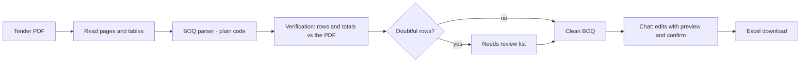

# Bidding Helper AI

A free chatbot for contractors. Upload a tender PDF (EPADS format) and ask it to:

- build the **BOQ as an Excel file**,
- list the tender **requirements**, **forms**, dates and money figures,
- edit rates on rows you choose (with a preview first),
- translate item descriptions into **Urdu**.

Uncertain items are shown under **needs review** instead of being guessed. Always
check results against the PDF before bidding.

**Status:** under construction. See [docs/ROADMAP.md](docs/ROADMAP.md).

## How it works

## What makes it different

| Promise | How it is kept |
|---|---|
| No invented BOQ rows | Rows are read by code from the PDF tables; the LLM never writes the BOQ |
| Numbers are checked | Sum of rows is compared with the total printed in the PDF; blank rates are reported, not guessed |
| Doubtful rows are shown | Anything unusual goes to the needs-review list with its page number |
| Every claim is testable | Hand-checked answers and stress cases run automatically on every push |

## Evaluation (BOQ parser, phase 1)

Full report: [evaluation/RESULTS.md](evaluation/RESULTS.md). Known problems: [evaluation/BUG_REPORT.md](evaluation/BUG_REPORT.md).

<!-- EVAL:START -->
| Metric | Result | Target | |
|---|---|---|---|
| Rows found (of hand-checked rows) | 100.0% | >= 98% | pass |
| Quantity correct | 100.0% | >= 99% | pass |
| Unit correct | 100.0% | >= 99% | pass |
| Rate correct | 100.0% | >= 99% | pass |
| Amount correct | 100.0% | >= 99% | pass |
| Printed total check gives the expected outcome | 100.0% | >= 100% | pass |
| Section headings found correctly | 100.0% | >= 95% | pass |
| Critical: Invented rows (not in the tender) | 0 | 0 | pass |
| Critical: Wrong values NOT flagged for review | 0 | 0 | pass |
| Critical: Missing rows with no warning | 0 | 0 | pass |
| Stress probes passed | 13 of 13 | all | pass |
<!-- EVAL:END -->

The sample is small (3 tenders). The hand-checked answers are a draft until
[evaluation/gold/SPOT_CHECK.md](evaluation/gold/SPOT_CHECK.md) has been checked by a person.

## Run the tests in Google Colab

Open `notebooks/colab_run.ipynb` in Colab and run the cells from top to bottom.

## Bring your own API key

Each person uses their own free LLM keys (Gemini, Groq). Keys stay in the browser
session only and are never saved or committed.

## License
This project is licensed under the Apache License 2.0. See the [LICENSE](LICENSE) file for details.
