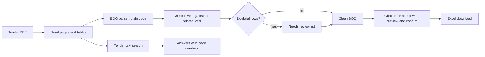

# Bidding Helper AI

A free helper for contractors. Upload a tender PDF (EPADS format) and it will:

- read the **BOQ**, check it against the totals printed in the tender, and give you an **Excel file**,
- let you **edit rates in plain words** (with a preview first) and undo,
- answer questions about **requirements, forms, dates and security**, with page numbers,
- list the **forms** of the tender and extract its **key facts**,
- translate item descriptions into **Urdu**,
- **save your work** in a file, with no account needed.

**Live app: https://bidding-ai.streamlit.app/** (free; you bring your own free AI key)

Items it is not sure about are shown under **Needs review** instead of being guessed. Always check results against the tender before bidding.

## Try it in three steps

1. Get a free key: Groq at console.groq.com/keys or Gemini at aistudio.google.com/apikey. See the [user guide](docs/USER_GUIDE.md).
2. Open the app, paste the key in the sidebar and press **Use and test keys**.
3. Upload a tender PDF and use the **Chat** tab, for example: `increase items 3 to 5 by 10%` or `what is the bid security?`

## How it works

## What makes it different

| Promise | How it is kept |
|---|---|
| No invented BOQ rows | Rows are read by code from the PDF tables; the AI never writes the BOQ |
| Numbers are checked | The sum of the rows is compared with the total printed in the tender; blank rates are reported, not guessed |
| Doubtful rows are shown | Anything unusual goes to the needs-review list with its page number |
| Edits are safe | Every edit is previewed and needs a click on Apply; only the rows you name change; the arithmetic is done by code |
| Answers can be checked | Answers cite the PDF page and the printed page, and the AI's exact words are checked against the page |
| Your data stays with you | Nothing is stored on a server; keys stay in your browser session; sessions are saved as a file on your computer |

## Results so far

Small samples (three public tenders), so read them as a rough guide. Details and per-case results are in the `evaluation` folder.

**BOQ parser** against hand-checked answers:

<!-- EVAL:START -->
| Metric | Result | Target | |
|---|---|---|---|
| Rows found (of hand-checked rows) | 100.0% | >= 98% | pass |
| Quantity correct | 100.0% | >= 99% | pass |
| Unit correct | 100.0% | >= 99% | pass |
| Rate correct | 100.0% | >= 99% | pass |
| Amount correct | 100.0% | >= 99% | pass |
| Printed total check gives the expected outcome | 100.0% | >= 100% | pass |
| Section headings found correctly | 100.0% | >= 95% | pass |
| Critical: Invented rows (not in the tender) | 0 | 0 | pass |
| Critical: Wrong values NOT flagged for review | 0 | 0 | pass |
| Critical: Missing rows with no warning | 0 | 0 | pass |
| Stress probes passed | 13 of 13 | all | pass |
<!-- EVAL:END -->

- **Chat:** 26 of 26 test sentences handled correctly with Groq (gpt-oss-120b).
- **Tender questions:** the right page was found for 15 of 15 questions; 14 of 15 answers were fully correct on the first run (the miss was an equally valid second page, since added to the answer key); none of the 2 questions the tender cannot answer got an invented answer.
- **Urdu:** checked by program for kept numbers and glossary words; the quality needs a person's review.

Full reports: [BOQ parser results](evaluation/RESULTS.md), [chat results](evaluation/RESULTS_CHAT.md), [tender question results](evaluation/RESULTS_TENDER.md), [bug report](evaluation/BUG_REPORT.md).

## Known limits

Scanned PDFs are not supported yet; it was tested on three EPADS tenders; the free AI keys have small limits; the free server sleeps and has limited memory. Read the full list in [docs/KNOWN_LIMITS.md](docs/KNOWN_LIMITS.md).

## Privacy

Your PDF is read on the app's server and kept only in memory during your session. The few passages needed for a question, and your message, are sent to Google (Gemini) or Groq with your own key. Session files contain your rates; keep them private.

## For developers

See the [developer guide](docs/DEVELOPER_GUIDE.md) and the [roadmap](docs/ROADMAP.md). Run the tests with `python -m pytest -q`. The project uses Python, Streamlit, pdfplumber, openpyxl, and plain HTTPS calls to Gemini and Groq. See the LICENSE file for the licence.
